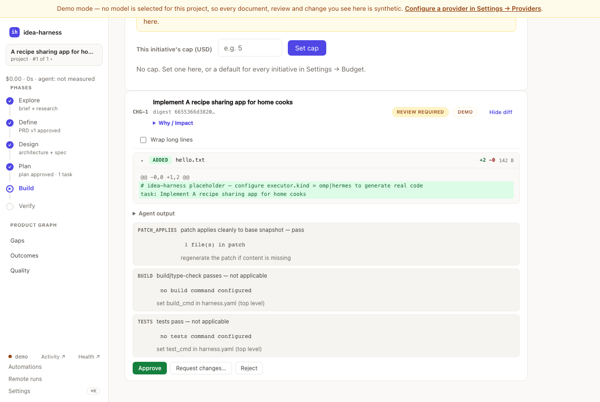

# idea-harness

A local-first control plane for AI product development. It takes an idea to verified software:
a reviewed PRD, an execution plan, change sets written by a real coding agent, and verification,
with you deciding at every point that matters.

```text
idea → reviewed PRD → execution plan → change set → apply → verify → outcome metrics
```

**Status:** pre-1.0. The whole pipeline runs end to end. With no API key it runs on a built-in
demo provider, so you can try everything before paying for a model call.

- [Install](#install)
- [Quick start](#quick-start)
- [Using the web UI](#using-the-web-ui)
- [How it works](#how-it-works)
- [Model providers](#model-providers)
- [Other ways in](#other-ways-in)
- [Documentation](#documentation)
- [Development](#development)

## Install

You need **Go 1.25.5 or newer** on **macOS or Linux** (Windows is not supported). Node.js and pnpm
are needed only to build the web UI.

```bash
git clone git@github.com:devarispbrown/idea-harness.git
cd idea-harness
make build                     # builds the web UI and the binary (needs Node.js + pnpm)
export PATH="$PWD/bin:$PATH"   # add to your shell profile to keep it
idea doctor                    # checks your setup
```

No Node? `go install ./cmd/idea` gives you the complete CLI, but the web UI then shows a "web UI
not built" page. Release binaries have the UI built in. Once the repository is public, Homebrew
will install them: `brew install devarispbrown/tap/idea-harness`.

**Upgrading:** the daemon runs in the background and outlives the binary that started it. After
installing a new build, run `idea daemon stop`; the next command starts the new one. If you forget,
`idea doctor` fails and names both builds.

Supported platforms, and how to verify a signed release: [`RELEASING.md`](RELEASING.md).

## Quick start

This runs the whole loop on the demo provider. No key, about two minutes.

```bash
mkdir my-product && cd my-product
idea init                              # creates .idea-harness/ and starts the daemon
idea new "Build usage-based billing"   # idea → reviewed PRD
idea next --until-human                # design → plan → change set, then stops for you
idea review CHG-1 approve              # approve the change set
idea apply CHG-1                       # write it to your workspace
idea verify REQ-1 --pass               # record evidence; repeat per requirement
idea next                              # → "✓ initiative complete"
```

`idea next` always runs the next automatic step and stops where a person has to decide, printing
the command to run next. `idea new` waits for the run it starts (`--no-wait` returns at once, and
`idea watch` follows a run live). `idea status` shows where things stand.

**With a real model:**

1. Export your key **before** `idea init`: `export OPENAI_API_KEY=sk-…`. The daemon reads the
   environment once, when it starts. If you forgot, run `idea daemon stop` and continue.
   `idea doctor` asks the **daemon** whether it has the key, so it catches this.
2. Pick a model: `idea model set openai/gpt-5.6-luna`. Only set a model whose key you have.
3. With Docker running too, `idea execute` uses a real coding agent automatically.

A real model's reviewer can push back, so the loop may stop earlier and ask you to `idea approve`
or `idea revise` the PRD. If `idea review CHG-1 approve` refuses because of reviewer findings,
`idea reviews` lists them and `idea review CHG-1 approve --accept-findings` signs them off.
Requirement codes may not start at `REQ-1`; `idea status` lists the live ones. If an initiative
fails, `idea retry` re-runs the phase that failed.

If a *change set* is what's stuck instead — a review that never finished, a secret-sweep
rejection, a revert that refuses — see [`docs/failure-modes.md`](docs/failure-modes.md):
the real command, the real message, and the way out, for each one we've hit.

Step-by-step walkthroughs, with the output at each step:
[new project](docs/demo-greenfield.md), [existing codebase](docs/demo-existing-project.md), and
the [annotated quickstart](docs/quickstart.md), which covers what a real model and agent cost.

## Using the web UI

The daemon serves the UI at **http://127.0.0.1:8787/**. It starts with your first `idea` command,
so open that address in a browser once you have run `idea init`. `idea daemon status` prints the
address if you are not sure. The UI and the CLI share the same state,
so you can switch between them at any point.



**Getting around.** The sidebar holds the initiative's six phases (**Explore → Define → Design →
Plan → Build → Verify**). Each shows a check when done and highlights the one in progress. Below
them are the Product Graph views (**Gaps**, **Outcomes**, **Quality**), and at the bottom
**Activity**, **Health**, **Automations**, **Remote runs** and **Settings**. Press **⌘K**
(Ctrl+K) to jump anywhere, including typing a code like `REQ-3` to open its lineage. Press **?**
for every shortcut.

**A typical session:**

1. **Home:** type an idea into "What are you thinking about building?" and press Enter.
2. **Explore and Define:** read the brief, research and PRD (**Read** opens the document).
   Answer open questions in place (**✨ Suggest** drafts an answer). Approve the PRD or send it
   back.
3. **Design and Plan:** review the architecture and the dependency-ordered tasks, then approve
   the plan.
4. **Build:** while the agent runs, the run panel streams what it is doing. You can stop it, and
   ACP and OpenHands agents also take a note mid-run. When a change set is ready, open **View diff**, then **Approve**,
   **Request changes…** or **Reject**, then **Apply**.
5. **Verify:** mark each requirement **Pass** or **Fail** with evidence, and see the quality
   scorecard.

**Needs you** collects every open decision, question and review finding across initiatives,
highest impact first. **Settings** is where you set the model, providers, coding agent, git,
review rigor, spending caps and integrations, so you don't need to edit YAML.

**From your phone.** Remote access is off by default. Turn it on (Tailscale is the recommended
way), run `idea ui pair --qr` on your machine, and sign in on the phone with the pairing code. You
can then review diffs, approve and get push notifications. Setup:
[configuration → remote access](docs/configuration.md#remote-access).

Every screen and route is described in [`docs/ui.md`](docs/ui.md).
[`docs/ui-parity.md`](docs/ui-parity.md) lists which CLI commands have a UI equivalent.

## How it works

idea-harness is not a coding agent itself. It drives one (Hermes, OMP, any Agent Client Protocol
agent such as Claude Code or Codex, or an OpenHands Agent Server) inside its gates. A team of AI
roles (product manager, research analyst, architect, product designer, engineering lead,
verification engineer, adversarial reviewer) moves each initiative through the phases. Every artifact is reviewed before it reaches you.

**Product Graph.** Every objective, requirement, decision, task, change set, test and
verification is a node, with edges recording why it exists and what depends on it.

```bash
idea why requirement REQ-1      # the evidence and decisions behind it
idea impact requirement REQ-1   # what goes stale if you change it
idea gaps                       # unbuilt or unverified requirements, refuted assumptions, drifting metrics, …
idea changed                    # what changed since you last looked
```

**Byte-for-byte revert.** Each applied change set is stored as a content-addressed patch, so
`idea revert CHG-1` restores the exact previous files. Revert works on files, not git history. For
a git commit per change set as well, set `git_commit: true` in `.idea-harness/harness.yaml`.

**Coding agents.** By default (`auto`), `idea execute` runs the pinned Hermes agent when Docker
is running and the model's key is set. Otherwise it writes a clearly labelled placeholder instead
of real code. Choose another agent with `idea executors setup`; see [`docs/agents.md`](docs/agents.md).
Tasks run one at a time per initiative, in dependency order.

**Verification.** `idea verify` records evidence per requirement. It also scores seven quality
dimensions: setup reproducibility, docs, API compatibility, API ergonomics, security, performance
and operational readiness. Anything it could not check is reported as "not measured", never as a
pass. See [configuration → quality dimensions](docs/configuration.md#quality-dimensions-verify).

**Objectives and outcomes.** The PRD states objectives (`OBJ-n`) and the outcome metrics that
measure them (`MET-n`). Every requirement says which objective it serves. Record or measure
metric values with `idea metric record` or `idea metric measure`. idea-harness flags a metric that
is off track or regressed after a change landed, and a requirement that is verified but whose
objective is failing. See [configuration → objectives & outcomes](docs/configuration.md#objectives--outcomes).

**Guardrails.** Hard deny rules, protected paths, credential and PII sweeps, a no-network check
sandbox, redacted logs and per-initiative spending caps. See [`docs/security.md`](docs/security.md)
and [`docs/security-model.md`](docs/security-model.md).

**Your own material.** Attach a PRD, spec or mockup and every later stage works from it:
`idea new "…" --doc prd.md`, or `idea docs add spec.pdf` afterwards. Text is swept for credentials
when it is uploaded; images are not
([details](docs/security.md#context-docs-uploaded-source-material)).

## Model providers

Built-in presets: **OpenAI, Anthropic, Google Gemini, DeepSeek, OpenRouter and Ollama** (local).
Any OpenAI-compatible endpoint works too. Configure them in Settings or from the CLI:

```bash
idea model                        # list providers and whether each has its key
idea model set gemini/gemini-3.6-flash
idea model add groq --type openai --base-url https://api.groq.com/openai/v1 --key-env GROQ_API_KEY
```

Keys are always read from environment variables and never stored in config. With no provider
configured, idea-harness runs in demo mode and labels its synthetic output everywhere. More:
[`docs/configuration.md`](docs/configuration.md#supported-providers).

## Other ways in

- **MCP server:** `claude mcp add idea -- idea mcp` drives idea-harness from Claude Code, Cursor or
  Codex ([`docs/mcp.md`](docs/mcp.md)).
- **Slack and Linear:** notifications and approvals in Slack, two-way Linear issue sync, with no
  public URL needed ([`docs/integrations.md`](docs/integrations.md)).
- **HTTP API:** everything the UI does ([`docs/api.md`](docs/api.md)). A running daemon serves the
  reference at http://127.0.0.1:8787/api-reference.
- **Evals:** `idea eval` runs a fixed suite of ideas end to end and compares the results against a
  saved baseline ([`docs/cli.md`](docs/cli.md#measuring-the-pipeline-idea-eval)).

## Documentation

| Start here | Using it | Building on it and trusting it |
|---|---|---|
| [Greenfield demo](docs/demo-greenfield.md) | [Web UI](docs/ui.md) | [HTTP API](docs/api.md) and [OpenAPI spec](docs/openapi.yaml) |
| [Existing-project demo](docs/demo-existing-project.md) | [CLI reference](docs/cli.md) | [Architecture](docs/architecture.md) |
| [Quickstart](docs/quickstart.md) | [Configuration](docs/configuration.md) | [Security](docs/security.md) |
| | [Coding agents](docs/agents.md) | [Security model](docs/security-model.md) |
| | [MCP](docs/mcp.md) and [integrations](docs/integrations.md) | [Hosting the API reference](docs/api-reference-hosting.md) |

Project records: [`CHANGELOG.md`](CHANGELOG.md) (breaking changes and migrations),
[`CONTRIBUTING.md`](CONTRIBUTING.md), [`RELEASING.md`](RELEASING.md), and
[`docs/plans/`](docs/plans/), which includes the [deferred items](docs/plans/deferred.md).

## Development

```bash
make test     # Go tests
make vet      # go vet
make build    # web UI + binary
make e2e      # browser tests and accessibility checks
```

Layout: `cmd/idea/` (CLI and daemon), `internal/` (Go packages), `web/` (React UI), `docs/`,
`scripts/`. Pre-1.0, the CLI, API and config may change in any release; `CHANGELOG.md` records
each change. `idea version` prints the build to quote in a bug report. Process:
[`CONTRIBUTING.md`](CONTRIBUTING.md).

## License

[Apache License 2.0](LICENSE). Copyright 2026 DeVaris Brown.
